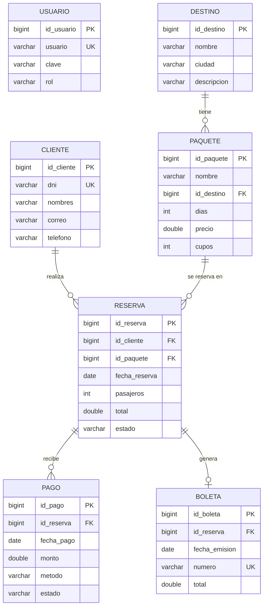

# Modelo de base de datos – SysTurismo

## Diagrama entidad-relación

(`USUARIO` no se relaciona con otras tablas: solo controla el acceso.)

## Cómo obtener el modelo en SQL Power Architect (archivo .architect)
1. Ejecute SysTurismo una vez (se crea la base H2) o use `database/systurismo.sql`.
2. En Power Architect: *Connections → Add Source Connection → New Connection*, driver **H2** (agregue el JAR de H2 en *JDBC Drivers*)
   y URL `jdbc:h2:file:C:/Users/SU_USUARIO/SysTurismo/data/systurismo`, usuario `sa`, sin contraseña.
3. Clic derecho en la conexión → **Add to Playpen** → *Add all to playpen*.
4. Ordene las tablas, muestre las relaciones y guarde con *File → Save Project* como `docs/SysTurismo.architect`.
5. Exporte la imagen con *File → Export Playpen to PNG* y agréguela a `docs/`.

> Nota: el archivo `.architect` debe generarse con la herramienta; este repositorio incluye el script `database/systurismo.sql` y el diagrama Mermaid como respaldo.
